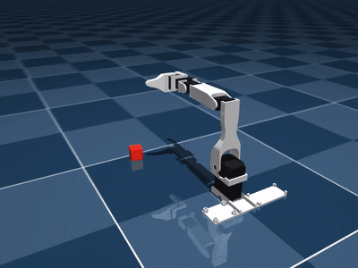
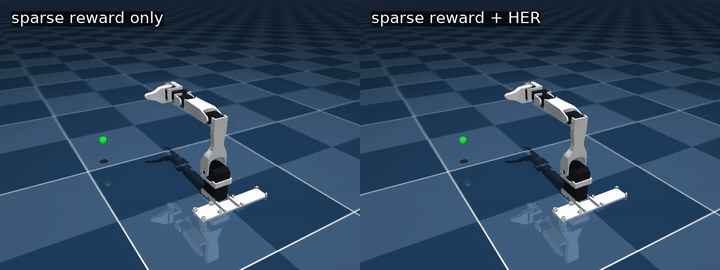
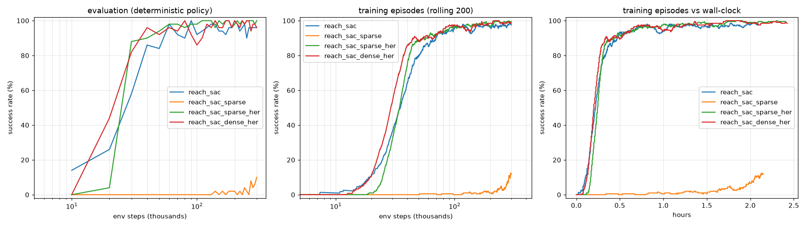

# Robot arm reinforcement learning

Reinforcement learning on a simulated 5-DoF + gripper robot arm (the Koch v1.1 "low-cost robot
arm" from [MuJoCo Menagerie](https://github.com/google-deepmind/mujoco_menagerie)). It includes
two tasks built from scratch as Gymnasium environments, trained with Stable-Baselines3, plus
controlled experiments on RL algorithms and reward design.

| Pick-and-lift (SAC, 96% success) | Reach with a sparse reward: without vs with HER |
|---|---|
|  |  |

## Highlights

- **Reach:** move the gripper within 1 cm of a random target.
  - **96%** success, median error 2.7 mm.
- **Pick-and-lift:** grasp a 2.5 cm cube, lift it 5 cm and hold it.
  - **96%** success after fixing a reward bug that had capped it at 20% (see [lessons learned](#lessons-learned)).
- **Experiment 1: SAC vs TD3 vs PPO.**
  - Off-policy SAC was about 2.5× more sample-efficient than PPO.
  - PPO still reached 90% success first in wall-clock time, because it simulates about 15× faster.
- **Experiment 2: shaped vs sparse reward, with and without Hindsight Experience Replay.**
  - With a sparse reward, SAC reached only **12%**.
  - Adding HER raised it to **96%**, matching the hand-designed reward with no reward engineering.

Full write-up with plots: **[reports/reach_experiments.md](reports/reach_experiments.md)**

<p align="center"></p>

## Results

### Reach: algorithms (shaped reward)

| | SAC | TD3 | PPO |
|---|---|---|---|
| Steps to 90% success | **60k** | 80k | 150k |
| Wall-clock to 90% | 0.47 h | 0.33 h | **0.12 h** |
| Final success (200 episodes) | 96% | 94% | 96% |

### Reach: reward design (SAC, 300k steps)

| Reward | Steps to 90% | Final success |
|---|---|---|
| Shaped | 60k | 96% |
| Sparse | never | 12% |
| Sparse + HER | **40k** | 96% |
| Shaped + HER | **40k** | 97% |

### Pick-and-lift (SAC, 2M steps, ~16 h)

| | Success (200 episodes) | Mean return |
|---|---|---|
| Best model | **96%** | 1798 ± 269 |
| Final model | 94% | 1765 ± 361 |

## Tasks

Both environments use 20 Hz control. Actions are *changes* to the joint position targets,
scaled to [-1, 1]. Observations are normalised to roughly [-1, 1].

| | Reach (`src/reach/env.py`) | Pick-and-lift (`src/pick_lift/env.py`) |
|---|---|---|
| Actions | 5 arm joints (gripper held open) | 5 arm joints + gripper |
| Observation | 24-dim: joint pos/vel, gripper & target position, joint targets; or a goal-conditioned dict for HER | 35-dim: joint pos/vel, gripper & cube position, cube orientation, finger contacts, joint targets |
| Episode | 100 steps (5 s) | 200 steps (10 s); ends early if the cube is knocked out of reach |
| Reward | shaped: `-10·dist + 1·[dist<1cm] − 0.01·‖a‖²`, or sparse: `0` if within 1 cm, else `-1` | staged: reach + close gripper near cube + both fingers touching + lift height while grasped + per-step bonus while held, − action penalty |
| Success | within 1 cm of the target | cube held ≥ 5 cm up for 3 steps |

Targets for reach are sampled from random collision-free arm poses, so every target is
reachable.

## Project layout

```
src/
  reach/
    env.py         reach environment (dense/sparse reward, optional goal-conditioned obs for HER)
    train.py       train/evaluate: --algo sac|td3|ppo, --reward dense|sparse, --her
    compare.py     learning-curve plots + summary table across runs
    runs/          trained models, logs, TensorBoard (git-ignored)
  pick_lift/
    env.py         pick-and-lift environment
    train.py       train/evaluate (SAC)
    runs/          (git-ignored)
  play.py          render any trained model to .mp4 / .webm / .gif (headless, via EGL)
reports/
  reach_experiments.md   experiment write-up
videos/                  rendered videos and plots
```

## Setup

Requires Python ≥ 3.12 and [uv](https://docs.astral.sh/uv/). A CUDA GPU is used automatically if
PyTorch sees one; the physics runs on the CPU. `ffmpeg` is needed for .mp4/.webm videos.

```bash
uv sync

# only the robot model is needed from MuJoCo Menagerie
git clone --filter=blob:none --sparse https://github.com/google-deepmind/mujoco_menagerie.git
git -C mujoco_menagerie sparse-checkout set low_cost_robot_arm
```

## Usage

```bash
# train (8 parallel simulators; runs are saved to src/<task>/runs/<name>/)
uv run src/reach/train.py --name reach_sac                          # SAC, shaped reward, 300k steps
uv run src/reach/train.py --reward sparse --her --name reach_her     # sparse reward + HER
uv run src/reach/train.py --algo ppo --timesteps 3000000 --name reach_ppo
uv run src/pick_lift/train.py --name pick_lift                       # 2M steps, ~16 h

# evaluate a saved model (success rate over N episodes)
uv run src/reach/train.py --eval src/reach/runs/reach_sac/best_model.zip --eval-episodes 200

# compare runs: table + plot of success vs steps and vs wall-clock time
uv run src/reach/compare.py reach_sac reach_her reach_ppo --out videos/compare.png

# render a video (works headless over SSH)
uv run src/play.py reach src/reach/runs/reach_sac/best_model.zip --episodes 3 --out videos/reach.mp4
uv run src/play.py pick_lift src/pick_lift/runs/pick_lift/best_model.zip --out videos/pick_lift.mp4

# live training curves
uv run tensorboard --logdir src/reach/runs
```

Each run folder contains `best_model.zip` (best evaluation), `final_model.zip`, periodic
`checkpoints/`, per-episode `monitor/*.csv`, `evaluations.npz`, TensorBoard logs and (for reach)
`config.json`. `--eval` and `play.py` use `config.json` to rebuild the matching environment.

## Lessons learned

- **The agent optimises the reward, not your intention.**
  - The first pick-and-lift version ended episodes on success, but paid a reward on every step.
    Hovering just below the lift height earned more than succeeding, so success peaked at 20%.
  - Fix: run every episode to full length and pay the success bonus on every step the cube is held.
    Result: 96% success.
- **Leftover reward exploits.** The pick-and-lift agent wiggles the cube around after lifting it.
  - Height reward is capped at 5 cm and the action penalty is tiny, so nothing pays for holding still.
  - Known issue, see the roadmap.
- **With sparse rewards, the bottleneck is exploration, not the algorithm.**
  - Sparse-only SAC learned only targets close to its start pose (0% success beyond 20 cm).
  - HER's goal relabelling fixed it completely.
- **Sample efficiency and wall-clock time are different things.**
  - SAC needs the fewest simulation steps.
  - PPO needs the least time when simulation is cheap.

## Roadmap

- [ ] Pick-and-lift: reward holding still and a target height, to remove the post-lift wiggling
- [ ] Multiple seeds per configuration with mean ± spread
- [ ] Sparse reward + HER for pick-and-lift / pick-and-place
- [ ] Implement Q-learning → DQN → PPO from scratch
- [ ] Locomotion: Walker2d → quadruped → humanoid (Berkeley Humanoid)

## Acknowledgements

- Robot model: [MuJoCo Menagerie](https://github.com/google-deepmind/mujoco_menagerie) (Koch v1.1 low-cost robot arm).
- Physics: [MuJoCo](https://mujoco.org).
- RL algorithms: [Stable-Baselines3](https://github.com/DLR-RM/stable-baselines3).
- HER: Andrychowicz et al., *Hindsight Experience Replay*, NeurIPS 2017.
