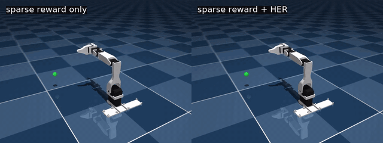
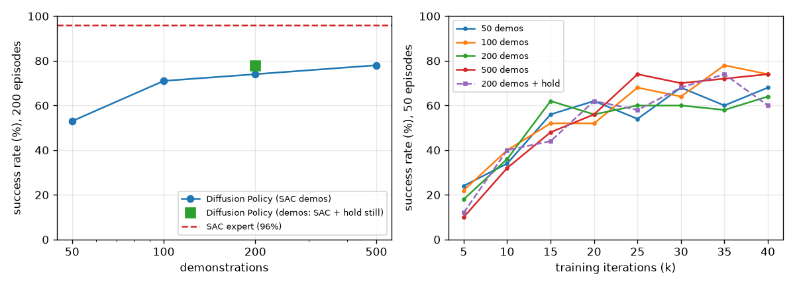
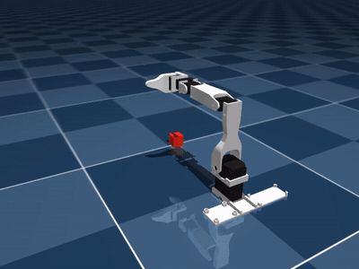

# Low-cost robot arm

Reinforcement learning on a simulated 5-DoF + gripper robot arm (the Koch v1.1 "low-cost robot
arm" from [MuJoCo Menagerie](https://github.com/google-deepmind/mujoco_menagerie)). It includes
two tasks built from scratch as Gymnasium environments, trained with Stable-Baselines3, plus
controlled experiments on RL algorithms and reward design, and imitation learning with a
Diffusion Policy trained on the RL expert's demonstrations.

| Pick-and-lift (SAC, 96% success) | Reach with a sparse reward: without vs with HER |
|---|---|
|  |  |

## Highlights

- **Reach:** move the gripper within 1 cm of a random target.
  - **96%** success, median error 2.7 mm.
- **Pick-and-lift:** grasp a 2.5 cm cube, lift it 5 cm and hold it.
  - **96%** success after fixing a reward bug that had capped it at 20% (see [lessons learned](#lessons-learned)).
- **Experiment 1: SAC vs TD3 vs PPO.**
  - Off-policy SAC was about 2.5× more sample-efficient than PPO.
  - PPO still reached 90% success first in wall-clock time, because it simulates about 15× faster.
- **Experiment 2: shaped vs sparse reward, with and without Hindsight Experience Replay.**
  - With a sparse reward, SAC reached only **12%**.
  - Adding HER raised it to **96%**, matching the hand-designed reward with no reward engineering.
- **Experiment 3: imitation learning with Diffusion Policy.**
  - A Diffusion Policy (written from scratch in PyTorch) learned pick-and-lift from demonstrations
    recorded with the SAC policy, with no reward.
  - It reached **78–82%** success, against the expert's 96%. More demos stopped helping after
    about 100, because most remaining failures were the cube slipping out of a copied grasp.

Full write-up with plots: **[reports/reach_experiments.md](reports/reach_experiments.md)**

<p align="center"></p>

## Results

### Reach: algorithms (shaped reward)

| | SAC | TD3 | PPO |
|---|---|---|---|
| Steps to 90% success | **60k** | 80k | 150k |
| Wall-clock to 90% | 0.47 h | 0.33 h | **0.12 h** |
| Final success (200 episodes) | 96% | 94% | 96% |

### Reach: reward design (SAC, 300k steps)

| Reward | Steps to 90% | Final success |
|---|---|---|
| Shaped | 60k | 96% |
| Sparse | never | 12% |
| Sparse + HER | **40k** | 96% |
| Shaped + HER | **40k** | 97% |

### Pick-and-lift: Diffusion Policy from SAC demonstrations

`diffusion/`: the SAC policy (99% success on the demo seeds) records successful episodes; a
state-based Diffusion Policy ([Chi et al. 2023](https://diffusion-policy.cs.columbia.edu/))
learns to reproduce them.

- **Input:** the last 2 observations.
- **Output:** the next 16 absolute joint targets, generated by denoising random noise with a
  1D U-Net (16.8M parameters; 100 DDPM training steps, 10 DDIM sampling steps).
- **Execution:** the first 8 targets run, then the policy plans again.
- **Training:** 40k gradient steps, about 45 min on the GPU.

| Demonstrations | Success (200 episodes) |
|---|---|
| 50 | 53% |
| 100 | 71% |
| 200 | 74% |
| 500 | 78% |
| 200, "hold still" demos* | 78% |
| *SAC expert* | *96%* |

\* SAC grasps and lifts; once the cube is held up, the arm's targets are frozen, so the demos
contain no post-lift wiggle.

<p align="center"></p>

Where the failures come from (100 episodes each):

| | Success | Lifted, then dropped | Grasped, never lifted | Never grasped |
|---|---|---|---|---|
| 200 demos | 75% | 14% | 10% | 1% |
| 200 "hold still" demos | 82% | 10% | 6% | 1% |
| 500 demos | 80% | 16% | 2% | 2% |

- The policy reaches, grasps and lifts almost every time. It mostly fails by dropping the cube
  while lifting or just after.
- More demos fixed grasps that never lifted (10% → 2%), but not the drops.
- A cleaner expert reduced the drops a little.
- Once the cube falls, the policy never tries again: the SAC demos contain no recoveries.

<p align="center"><br>
<sub>Diffusion Policy, 4 episodes: the second one drops the cube during the lift.</sub></p>

### Pick-and-lift (SAC, 2M steps, ~16 h)

| | Success (200 episodes) | Mean return |
|---|---|---|
| Best model | **96%** | 1798 ± 269 |
| Final model | 94% | 1765 ± 361 |

## Tasks

Both environments use 20 Hz control. Actions are *changes* to the joint position targets,
scaled to [-1, 1]. Observations are normalised to roughly [-1, 1].

| | Reach (`reach/env.py`) | Pick-and-lift (`pick_lift/env.py`) |
|---|---|---|
| Actions | 5 arm joints (gripper held open) | 5 arm joints + gripper |
| Observation | 24-dim: joint pos/vel, gripper & target position, joint targets; or a goal-conditioned dict for HER | 35-dim: joint pos/vel, gripper & cube position, cube orientation, finger contacts, joint targets |
| Episode | 100 steps (5 s) | 200 steps (10 s); ends early if the cube is knocked out of reach |
| Reward | shaped: `-10·dist + 1·[dist<1cm] − 0.01·‖a‖²`, or sparse: `0` if within 1 cm, else `-1` | staged: reach + close gripper near cube + both fingers touching + lift height while grasped + per-step bonus while held, − action penalty |
| Success | within 1 cm of the target | cube held ≥ 5 cm up for 3 steps |

Targets for reach are sampled from random collision-free arm poses, so every target is
reachable.

## Project layout

```
low_cost_robot_arm/
  reach/
    env.py         reach environment (dense/sparse reward, optional goal-conditioned obs for HER)
    train.py       train/evaluate: --algo sac|td3|ppo, --reward dense|sparse, --her
    compare.py     learning-curve plots + summary table across runs
    runs/          trained models, logs, TensorBoard (git-ignored)
  pick_lift/
    env.py         pick-and-lift environment
    train.py       train/evaluate (SAC)
    runs/          (git-ignored)
  diffusion/
    record.py      record demos from the SAC pick-and-lift policy (--hold: freeze after lifting)
    policy.py      Diffusion Policy: conditional 1D U-Net, DDPM training, DDIM sampling
    train.py       train/evaluate (success rate, same evaluation seeds as SAC)
    play.py        render a trained Diffusion Policy
    data/, runs/   demos, trained policies (git-ignored)
  play.py          render any trained model to .mp4 / .webm / .gif (headless, via EGL)
  reports/
    reach_experiments.md   experiment write-up
  videos/          rendered videos and plots
```

## Setup

Uses the repository's shared environment. See the [root README](../README.md#setup) for setup
(`uv sync` plus the `low_cost_robot_arm` model from MuJoCo Menagerie). A CUDA GPU is used
automatically if PyTorch sees one; the physics runs on the CPU. `ffmpeg` is needed for .mp4/.webm
videos.

## Usage

Run from the repository root. Each run is saved to `low_cost_robot_arm/<task>/runs/<name>/`.

```bash
# train (8 parallel simulators)
uv run low_cost_robot_arm/reach/train.py --name reach_sac                        # SAC, shaped reward
uv run low_cost_robot_arm/reach/train.py --reward sparse --her --name reach_her   # sparse + HER
uv run low_cost_robot_arm/reach/train.py --algo ppo --timesteps 3000000 --name reach_ppo
uv run low_cost_robot_arm/pick_lift/train.py --name pick_lift                     # 2M steps, ~16 h

# evaluate a saved model (success rate over N episodes)
uv run low_cost_robot_arm/reach/train.py --eval-episodes 200 \
    --eval low_cost_robot_arm/reach/runs/reach_sac/best_model.zip

# compare runs: table + plot (default: low_cost_robot_arm/videos/reach_compare.png)
uv run low_cost_robot_arm/reach/compare.py reach_sac reach_her reach_ppo

# render a video, headless over SSH works (default: low_cost_robot_arm/videos/<task>.mp4)
uv run low_cost_robot_arm/play.py reach low_cost_robot_arm/reach/runs/reach_sac/best_model.zip
uv run low_cost_robot_arm/play.py pick_lift low_cost_robot_arm/pick_lift/runs/pick_lift/best_model.zip

# live training curves
uv run tensorboard --logdir low_cost_robot_arm/reach/runs

# Diffusion Policy: record demos (~6 min), train (~45 min on a GPU), evaluate, render
uv run low_cost_robot_arm/diffusion/record.py --episodes 500 --hold
uv run low_cost_robot_arm/diffusion/train.py --demos 200 --name dp_200_hold \
    --data low_cost_robot_arm/diffusion/data/demos_500_hold.npz
uv run low_cost_robot_arm/diffusion/train.py --eval low_cost_robot_arm/diffusion/runs/dp_200_hold/model.pt
uv run low_cost_robot_arm/diffusion/play.py low_cost_robot_arm/diffusion/runs/dp_200_hold/model.pt
```

Each run folder contains `best_model.zip` (best evaluation), `final_model.zip`, periodic
`checkpoints/`, per-episode `monitor/*.csv`, `evaluations.npz`, TensorBoard logs and (for reach)
`config.json`. `--eval` and `play.py` use `config.json` to rebuild the matching environment.

## Lessons learned

- **The agent optimises the reward, not your intention.**
  - The first pick-and-lift version ended episodes on success, but paid a reward on every step.
    Hovering just below the lift height earned more than succeeding, so success peaked at 20%.
  - Fix: run every episode to full length and pay the success bonus on every step the cube is held.
    Result: 96% success.
- **Leftover reward exploits.** The pick-and-lift agent wiggles the cube around after lifting it.
  - Height reward is capped at 5 cm and the action penalty is tiny, so nothing pays for holding still.
- **With sparse rewards, the bottleneck is exploration, not the algorithm.**
  - Sparse-only SAC learned only targets close to its start pose (0% success beyond 20 cm).
  - HER's goal relabelling fixed it completely.
- **Sample efficiency and wall-clock time are different things.**
  - SAC needs the fewest simulation steps.
  - PPO needs the least time when simulation is cheap.
- **Imitation copies the expert's flaws and adds its own errors.**
  - SAC's grasp works with little margin. A copy that is a few millimetres off lets the cube
    slip, and more demos of the same expert did not fix that.
  - The demos contain only successes, so the copy has never seen a recovery: after a drop it
    keeps "holding" nothing.
  - Better data (a steadier expert, recoveries, demos with perturbations) is the next lever,
    not a bigger model.

## Acknowledgements

- Robot model: [MuJoCo Menagerie](https://github.com/google-deepmind/mujoco_menagerie) (Koch v1.1 low-cost robot arm).
- Physics: [MuJoCo](https://mujoco.org).
- RL algorithms: [Stable-Baselines3](https://github.com/DLR-RM/stable-baselines3).
- HER: Andrychowicz et al., *Hindsight Experience Replay*, NeurIPS 2017.
- Diffusion Policy: Chi et al., *Diffusion Policy: Visuomotor Policy Learning via Action
  Diffusion*, RSS 2023.
