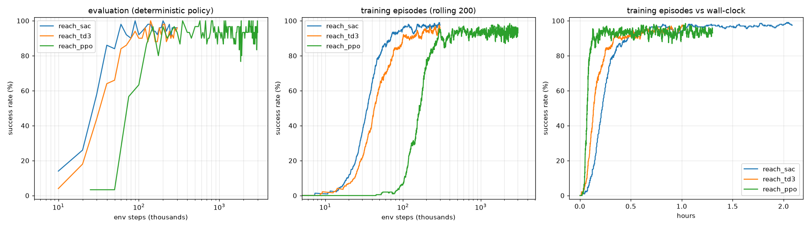

# What makes a robot arm learn to reach? Algorithms, reward design and HER

Two controlled experiments on a 5-DoF robot arm reaching task: **(1)** off-policy vs on-policy
algorithms (SAC, TD3, PPO) and **(2)** shaped vs sparse rewards, with and without Hindsight
Experience Replay (HER). In each experiment only one thing changes; everything else
(environment, network size, discount, seed, success criterion) is held fixed.

## Task

- **Robot:** Koch v1.1 "low-cost robot arm" from MuJoCo Menagerie, simulated in MuJoCo 3.
- **Goal:** move the gripper centre to within **1 cm** of a random target (green ball) and stay there.
  - Targets are sampled from random collision-free arm poses, so every target is reachable.
  - Targets range from 3 to 40 cm from the start position.
- **Action:** per-step change of the 5 joint position targets, at 20 Hz control.
- **Episode:** 100 steps (5 s), no early termination.
- **Success:** within 1 cm at the last step.
- **Code:**
  - `low_cost_robot_arm/reach/env.py`: Gymnasium environment.
  - `low_cost_robot_arm/reach/train.py`: training with stable-baselines3; `--algo`, `--reward` and `--her` flags.
  - `low_cost_robot_arm/reach/compare.py`: comparison plots and tables.
  - `low_cost_robot_arm/play.py`: video rendering.

Shared settings: 8 parallel simulators, network with 2 hidden layers of 256 units, γ = 0.95,
seed 0, evaluation every 10k steps.
Final numbers come from 200 held-out episodes using the deterministic policy.

Hardware: one Quadro RTX 4000 GPU plus CPU simulators. Wall-clock times are approximate,
because some runs shared the machine.

---

## Experiment 1: SAC vs TD3 vs PPO (shaped reward)



| | SAC | TD3 | PPO |
|---|---|---|---|
| Family | off-policy, stochastic, entropy-regularised | off-policy, deterministic + noise | on-policy, clipped policy gradient |
| Budget | 300k steps | 300k steps | 3M steps |
| Steps to 50% / 90% eval success | **30k / 60k** | 40k / 80k | 75k / 150k |
| Wall-clock to 90% (training episodes) | 0.47 h | 0.33 h | **0.12 h** |
| Throughput | ~50 steps/s | ~100 steps/s | ~750 steps/s |
| Final success (200 episodes) | 96% | 94% | 96% |
| Median / worst final error | 2.7 / 46 mm | 4.2 / 90 mm | **1.3** / 278 mm |

**Takeaways**
- **Off-policy methods are about 2.5× more sample-efficient.** SAC and TD3 reuse every transition
  from a replay buffer many times. PPO uses each rollout for 10 epochs and then discards it.
- **PPO still reached 90% first in wall-clock time.** It does far fewer gradient updates per
  step, so it simulates about 15× faster. When simulation is cheap (massively parallel GPU
  simulators), PPO wins; when samples are expensive (real robots), off-policy wins.
- **SAC beat TD3 in both learning speed and precision.** Its learned, state-dependent exploration
  worked better than TD3's fixed Gaussian noise.
- **PPO was the least consistent.**
  - Evaluation success fluctuated between 77% and 100% across checkpoints.
  - One test episode missed by 28 cm.
  - The last 2.7M of its 3M steps added nothing.
- **Training is reproducible.** Re-running SAC with the same seed reproduced the original run exactly.

---

## Experiment 2: Shaped vs sparse reward, with and without HER (all SAC)

| Reward | Definition |
|---|---|
| **Shaped (dense)** | `-10·distance + 1·[distance < 1 cm] − 0.01·‖action‖²`: says "warmer / colder" every step |
| **Sparse** | `0` if distance < 1 cm, else `−1`: says only "there yet or not" |

**HER** (Andrychowicz et al., 2017) stores each transition a second time, with the goal replaced by
positions the arm *actually reached* later in the same episode. A failed attempt at target A
becomes a successful demonstration of reaching B. We used the `future` strategy with 4 relabelled
goals per transition.


| Run | Steps to 50% / 90% eval | Final success (200 episodes) | Median / worst final error |
|---|---|---|---|
| Shaped | 30k / 60k | 96% | 2.7 / 46 mm |
| **Sparse** | never / never | **12%** | 136 / 438 mm |
| **Sparse + HER** | 30k / **40k** | **96%** | 4.6 / **16 mm** |
| Shaped + HER | 30k / **40k** | **97%** | 3.5 / 30 mm |

**Why sparse-only fails: it learns only what it stumbles into.** Success rate of the final
policies, grouped by how far the target starts from the gripper:

| Initial distance | 0–5 cm | 5–10 cm | 10–15 cm | 15–20 cm | > 20 cm |
|---|---|---|---|---|---|
| Sparse | 33% | 28% | 12% | 9% | **0%** |
| Sparse + HER | 100% | 100% | 95% | 98% | **91%** |

With a −1 reward everywhere except a 1 cm ball, random exploration almost never finds a
success, so the critic has nothing to learn from. The few successes the agent did find were
targets that happened to be close to its start pose. After 300k steps it had learned those and
nothing else; its curve was only beginning to rise at the end of the budget.

Video, same three targets for both agents: `low_cost_robot_arm/videos/reach_sparse_vs_her.mp4`.
The sparse-only agent curls up without moving toward distant targets, while the HER agent
reaches each one.

**Takeaways**
- **Exploration, not the learning algorithm, is the bottleneck with sparse rewards.**
  The same SAC went from 12% to 96% just by relabelling its own failures (HER).
- **HER with a sparse reward matched hand-shaped rewards**, and reached 90% faster
  (40k vs 60k steps), with no reward engineering.
  - This matters because shaped rewards can be exploited. In this project's pick-and-lift
    task, a shaped reward first made hovering more profitable than succeeding, and later
    let the arm wiggle the cube around after lifting it.
  - A sparse success signal cannot be gamed that way.
- **HER also helped the shaped reward** (90% at 40k vs 60k steps): relabelled goals are extra
  training data for free.
- **Cost:** HER needs goal-conditioned observations and a reward that can be recomputed for any
  goal (`compute_reward`). That's easy for reaching, harder for tasks without a clear goal state.

---

## Reproduce

```bash
uv sync
# experiment 1
uv run low_cost_robot_arm/reach/train.py --algo sac --name reach_sac
uv run low_cost_robot_arm/reach/train.py --algo td3 --name reach_td3
uv run low_cost_robot_arm/reach/train.py --algo ppo --timesteps 3000000 --eval-freq 25000 --eval-episodes 30 --name reach_ppo
uv run low_cost_robot_arm/reach/compare.py reach_sac reach_td3 reach_ppo
# experiment 2
uv run low_cost_robot_arm/reach/train.py --reward sparse --name reach_sac_sparse
uv run low_cost_robot_arm/reach/train.py --reward sparse --her --name reach_sac_sparse_her
uv run low_cost_robot_arm/reach/train.py --reward dense --her --name reach_sac_dense_her
uv run low_cost_robot_arm/reach/compare.py reach_sac reach_sac_sparse reach_sac_sparse_her reach_sac_dense_her \
    --out low_cost_robot_arm/videos/reach_reward_her.png
# evaluate / render any run
uv run low_cost_robot_arm/reach/train.py --eval low_cost_robot_arm/reach/runs/reach_sac_sparse_her/best_model.zip --eval-episodes 200
uv run low_cost_robot_arm/play.py reach low_cost_robot_arm/reach/runs/reach_sac_sparse_her/best_model.zip --out low_cost_robot_arm/videos/her.mp4
```

**Limitations**
- One seed per configuration. Differences of a few percent (e.g. 94% vs 97%) are within noise;
  the large effects (12% vs 96%, 2.5× sample efficiency) are not.
- The sparse-only run might eventually learn with a much larger budget.
- The wall-clock comparisons were measured with runs sharing one machine.
