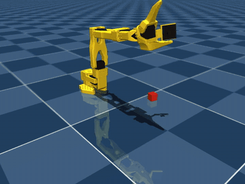

# SO-101

Reinforcement learning on a simulated SO-101, the 5-DoF + gripper arm used by
[LeRobot](https://github.com/huggingface/lerobot). The model is
[`robotstudio_so101`](https://github.com/google-deepmind/mujoco_menagerie/tree/main/robotstudio_so101)
from MuJoCo Menagerie. The pick-and-lift task and SAC setup are ported unchanged from the
[Koch v1.1 arm](../low_cost_robot_arm/), so this tests whether that recipe carries over to the
arm people actually build with LeRobot. The SAC policy is then distilled into a camera-based
policy that sees only what a real SO-101 has: two cameras and its joint readings. A controlled
study of that distillation shows that what limits the student's robustness is the data it is
trained on, not the teacher: with perturbed data collection the camera-only student recovers
from a moved cube more often than the state-based teacher it learned from.

<table>
  <tr>
    <td width="50%"></td>
    <td width="50%"></td>
  </tr>
  <tr>
    <td align="center">SAC from simulator state, 92% success</td>
    <td align="center">camera-only student, 90% success (top left: its two 84×84 camera images)</td>
  </tr>
</table>

## Highlights

- **Pick-and-lift with SAC: 92% success** over 200 evaluation episodes (cube 2.5 cm, random
  position and yaw, lift 5 cm and hold).
- **Same recipe, new robot:** only the robot-specific parts changed (joint names, jaw geometry,
  gripper direction, workspace). Reward, observation layout, action interface and SAC
  hyperparameters are the Koch ones. Eval success first hit 95% at 525k steps (Koch: 325k).
- **Camera-only policy close to the teacher: 90% success** (mean of 3 training seeds; teacher
  92.5%). A CNN student sees two 84×84 cameras (wrist and front) plus the joint readings, no
  cube pose and no contact sensors. It was trained with DAgger to copy the SAC policy, in 2.6 h.
- **DAgger vs behaviour cloning:** on the nominal task they are close (90% vs 87%). When the
  cube is moved 4 cm mid-episode, the DAgger student recovers about 6× as often (27% vs 5%),
  and every DAgger seed beats every behaviour-cloning seed, because DAgger was trained on the
  states its own mistakes lead to.
- **The student beats its teacher:** collecting the DAgger data with the cube moved in half of
  the episodes raises recovery from 27% to **49%**, above the teacher's 41.5%, with the same
  teacher and no loss on the nominal task (92%). All 3 seeds land at 47–50%. Training a more
  robust teacher with SAC from scratch under the same perturbations failed (11% success).
- **No real robot needed.** LeRobot's own SO-101 simulation is
  [LeIsaac](https://github.com/LightwheelAI/leisaac) (Isaac Lab, NVIDIA GPU). There is no
  official LeRobot MuJoCo environment for the SO-101, so this one is built on the Menagerie model.

## Results

SAC, 16 parallel simulators, 800k steps, 6.1 h (one GPU).

| Steps | 125k | 175k | 275k | 325k | 525k | 675k | 775k |
|---|---|---|---|---|---|---|---|
| Eval success (20 episodes) | 0% | 10% | 45% | 65% | 95% | 95% | 85% |

| Model (200 episodes, seeds 10000+) | Success | Return |
|---|---|---|
| Best checkpoint (by eval return) | 88% | 1672 ± 439 |
| Final model | **92%** | 1712 ± 416 |
| *Koch v1.1, same recipe (2M steps)* | *96%* | |

A scripted IK grasp (straight down onto the cube, close, lift) was run first to check that
the task is physically feasible before training. It succeeded in 85% of episodes. Its failures
were far cubes that the arm cannot reach with the jaws pointing straight down; SAC learns
angled grasps and handles those.

### Camera-based policy (`vision/`)

The SAC policy (the teacher) reads the exact cube pose, which a real robot does not have. A
student policy learns to act from what a real SO-101 provides:

- **Input:** wrist camera + fixed front camera (84×84 RGB each) and joint positions, velocities
  and targets. No cube pose, no contact flags.
- **Network:** one DrQ-style conv encoder per camera (4 conv layers → 64 features), joined with
  the joints in a 256-256 MLP; random-shift image augmentation.
- **Training:** DAgger, 25 iterations of 64 episodes (320k samples) and 1500 gradient steps
  each. In iteration *i* the teacher drives with probability 0.7^*i*, otherwise the student;
  the teacher labels every visited state with its action, and the student regresses on it
  (MSE).
- **Baseline:** behaviour cloning, same amount of data, but the teacher always drives.

| Policy (200 episodes, seeds 10000+) | Sees | Success | Cube moved 4 cm at 2 s |
|---|---|---|---|
| SAC teacher | simulator state | 92.5% | 41.5% |
| **DAgger student** | cameras + joints | **89.6 ± 1.7%** (87.8–91.2) | **26.5 ± 7.1%** (22.3–34.7) |
| Behaviour-cloning student | cameras + joints | 87.0 ± 0.9% (86.5–88.0) | 4.6 ± 3.6% (0.7–7.8) |

Students: 3 training seeds per method, mean ± standard deviation over seeds (range in
brackets). The final student of each seed is evaluated 3 times on the same 200 episodes and
averaged, because student evaluations are not bit-for-bit repeatable: GPU convolutions give
tiny numerical differences that the contact-rich task amplifies (one seed-0 DAgger student
scored 34, 45 and 46 of 200 on the same perturbed episodes). The teacher (MLP) evaluates
identically every time.

<p align="center"></p>

- Both students come within a few points of the teacher on the nominal task. DAgger is ahead
  for most of training, but the seed bands overlap: on the nominal task alone the two methods
  are hard to tell apart.
- The difference shows off the expert's path. In the perturbation test the cube is teleported
  4 cm in a random direction at step 40, out of the gripper if it was held. The behaviour-cloning
  student has only seen the teacher's clean episodes and almost never re-grasps. The DAgger
  student was corrected in its own off-track states and recovers about 6× as often. The spread
  between DAgger seeds (22–35%) is large, so 3 seeds pin down the gap, not its exact size.
- Neither student beats the teacher here: the SAC teacher recovers 41.5% of the time. The
  next section asks whether that ceiling comes from the teacher or from the data.

### What limits the student's robustness: the teacher or the data?

After the experiment above the DAgger student recovers from a moved cube in 26.5% of episodes
and its teacher in 41.5%. Two explanations fit: the student copies a teacher that is itself
poor at recovering, or the student rarely sees a moved cube during training and never learns
what to do there. Two experiments separate them.

**A more robust teacher.** SAC trained from scratch with the cube moved (4 cm, random
direction, at a random step between 1 and 6 s) in 50% of the training episodes, otherwise the
same recipe and seed as the original teacher. It did not learn the task: 11% nominal success,
0.5% under perturbation. The training curves show why: the entropy coefficient rose to 1.8
(original run: ~0.1), the critic loss was 100–300× larger, and evaluation success peaked at
10% around 225k steps and then collapsed. Observations and rewards stay in their normal range
under perturbation, so this is an optimisation failure of SAC from scratch on the noisier
task, not an environment bug. Fine-tuning the original teacher with perturbations
(`train.py --init`) is the obvious fix, but it was not carried out.

**More recovery data, same teacher.** DAgger exactly as above with the original teacher, but
during data collection the cube is moved in 50% of the episodes (`distill.py
--collect-perturb-prob 0.5`). The teacher labels the states after the move like any other
state. Evaluation is the same as above (3 seeds, 3 evaluations each).

| Policy (200 episodes, seeds 10000+) | Success | Cube moved 4 cm at 2 s |
|---|---|---|
| SAC teacher | 92.5% | 41.5% |
| SAC teacher trained from scratch with perturbations | 11% | 0.5% |
| DAgger student | 89.6 ± 1.7% | 26.5 ± 7.1% |
| **DAgger student, perturbed data collection** | **91.7 ± 1.5%** (90.3–93.3) | **49.0 ± 1.6%** (47.2–50.3) |

- **The data is the limit, not the teacher.** With the same teacher, perturbed collection
  almost doubles recovery (26.5% → 49.0%) and costs nothing on the nominal task. The spread
  between seeds also shrinks from ±7.1 to ±1.6 points.
- **The student surpasses its teacher.** All three seeds recover more often than the teacher
  (47–50% vs 41.5%). A plausible reason: the teacher's action is reasonable in each single
  state after the move, but when the teacher drives itself it rarely ends up in those states
  and its errors compound. The student is trained on many such states, each labelled by the
  teacher, and so learns the recovery better than the teacher executes it.
- **Caveat:** the test perturbation (4 cm at step 40) lies inside the training distribution of
  the perturbed collection (4 cm at a random step from 20 to 120). This shows recovery from a
  kind of disturbance the student has seen, not generalisation to new ones; larger moves or
  repeated moves would test that.

## Task

`pick_lift/env.py`:

| | |
|---|---|
| Action (6) | per-step change of the joint-position targets in [-1, 1]; 20 Hz control |
| Observation (35) | joint positions, velocities and targets; grasp centre, cube position and orientation; jaw-contact flags |
| Reward | reach + close near the cube + both jaws on the cube + lift while grasped + bonus while held lifted − action penalty |
| Success | cube held ≥ 5 cm above the table, gripped by both jaws, for 3 steps |
| Episode | 200 steps (10 s); ends early only if the cube is knocked out of reach |
| Cube | 2.5 cm, 20 g, 13–25 cm from the shoulder axis, ±0.6 rad around forward, ±0.5 rad yaw |

Differences from the Koch version:
- Arm faces +x, and the gripper closes towards negative angles.
- The gripper target is limited to 1.0 rad (9 cm opening) instead of the full 1.75 rad (13 cm).
- MuJoCo timestep is the Menagerie default of 5 ms, with frame skip 10.

## Project layout

```
so101/
  pick_lift/
    env.py         pick-and-lift environment
    train.py       train/evaluate (SAC)
    runs/          trained models, logs, TensorBoard (git-ignored)
  vision/
    vision_env.py  camera observations (wrist + front, 84x84) on top of pick_lift/env.py
    distill.py     DAgger / behaviour cloning from the SAC teacher, evaluation (--perturb)
    play.py        render a student with its camera images inset
    plot.py        learning curves of the students
    runs/          (git-ignored)
  play.py          render a trained model to .mp4 / .webm / .gif (headless, via EGL)
  videos/          rendered videos and plots
```

## Setup

Uses the repository's shared environment; see the [root README](../README.md#setup). The SO-101
model is added to the sparse Menagerie checkout with:

```bash
git -C mujoco_menagerie sparse-checkout add robotstudio_so101
```

## Usage

Run from the repository root.

```bash
# train: 800k steps, ~6 h with one GPU
uv run so101/pick_lift/train.py --name so101_pick_lift --timesteps 800000 --n-envs 16

# evaluate a saved model (success rate over N episodes)
uv run so101/pick_lift/train.py --eval-episodes 200 \
    --eval so101/pick_lift/runs/so101_pick_lift/final_model.zip

# render a video (default: so101/videos/pick_lift.mp4)
uv run so101/play.py so101/pick_lift/runs/so101_pick_lift/final_model.zip --episodes 4

# live training curves
uv run tensorboard --logdir so101/pick_lift/runs

# teacher with the cube moved mid-episode in half of the training episodes (did not learn;
# see "What limits the student's robustness"); --init MODEL.zip fine-tunes a saved model instead
uv run so101/pick_lift/train.py --name so101_pick_lift_perturb --timesteps 800000 --n-envs 16 \
    --perturb-prob 0.5

# camera-based student: DAgger (~2.6 h with 8 simulators) and the behaviour-cloning baseline
uv run so101/vision/distill.py --name dagger
uv run so101/vision/distill.py --name bc --beta-decay 1
# more training seeds (the plot and table use seeds 0, 1, 2)
uv run so101/vision/distill.py --name dagger_s1 --seed 1
uv run so101/vision/distill.py --name bc_s1 --seed 1 --beta-decay 1
# DAgger with the cube moved in half of the collection episodes (seeds 0, 1, 2)
uv run so101/vision/distill.py --name dagger_pc --collect-perturb-prob 0.5
# evaluate (nominal, then with the cube moved mid-episode); "teacher" evaluates the SAC policy
uv run so101/vision/distill.py --eval so101/vision/runs/dagger/student.pt
uv run so101/vision/distill.py --eval so101/vision/runs/dagger/student.pt --perturb
uv run so101/vision/distill.py --eval teacher --perturb
# video with the policy's camera images, and the learning-curve plot
uv run so101/vision/play.py so101/vision/runs/dagger/student.pt --episodes 4
uv run so101/vision/plot.py
```

Camera rendering needs a working GPU EGL driver (`MUJOCO_GL=egl`). Without it MuJoCo falls back
to software rendering (llvmpipe), several hundred times slower with these meshes.

## Next steps toward the real arm

The camera-based student needs no simulator state, but it has only seen simulated images of
one fixed scene. Still missing before a real SO-101:
- visual domain randomization (lighting, colours, textures, camera pose), so the student does
  not depend on how the simulator draws the scene
- physics randomization (friction, mass, servo gains, latency), as done for the
  [Go2](../unitree_go2/#robustness)
- recovery tests outside the training perturbations (larger moves, repeated moves, pushes
  instead of teleports)
- LeRobot calibration so the simulated joint angles match the real servo readings

## Acknowledgements

- Robot model: [MuJoCo Menagerie](https://github.com/google-deepmind/mujoco_menagerie) (`robotstudio_so101`, SO-101 by The Robot Studio / Hugging Face).
- Physics: [MuJoCo](https://mujoco.org).
- RL algorithms: [Stable-Baselines3](https://github.com/DLR-RM/stable-baselines3).
- DAgger: Ross, Gordon and Bagnell, *A Reduction of Imitation Learning and Structured Prediction
  to No-Regret Online Learning*, AISTATS 2011.
- Image augmentation: Yarats, Kostrikov and Fergus, *Image Augmentation Is All You Need:
  Regularizing Deep Reinforcement Learning from Pixels* (DrQ), ICLR 2021.
