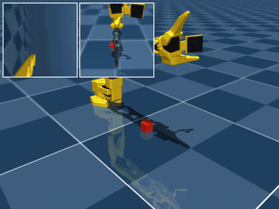
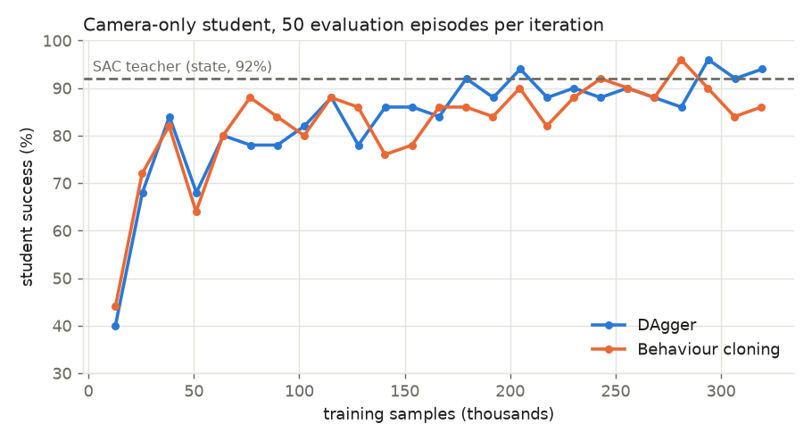

# SO-101

Reinforcement learning on a simulated SO-101, the 5-DoF + gripper arm used by
[LeRobot](https://github.com/huggingface/lerobot). The model is
[`robotstudio_so101`](https://github.com/google-deepmind/mujoco_menagerie/tree/main/robotstudio_so101)
from MuJoCo Menagerie. The pick-and-lift task and SAC setup are ported unchanged from the
[Koch v1.1 arm](../low_cost_robot_arm/), so this tests whether that recipe carries over to the
arm people actually build with LeRobot. The SAC policy is then distilled into a camera-based
policy that sees only what a real SO-101 has: two cameras and its joint readings.

<table>
  <tr>
    <td width="50%"></td>
    <td width="50%"></td>
  </tr>
  <tr>
    <td align="center">SAC from simulator state, 92% success</td>
    <td align="center">camera-only student, 93% success (top left: its two 84×84 camera images)</td>
  </tr>
</table>

## Highlights

- **Pick-and-lift with SAC: 92% success** over 200 evaluation episodes (cube 2.5 cm, random
  position and yaw, lift 5 cm and hold).
- **Same recipe, new robot:** only the robot-specific parts changed (joint names, jaw geometry,
  gripper direction, workspace). Reward, observation layout, action interface and SAC
  hyperparameters are the Koch ones. Eval success first hit 95% at 525k steps (Koch: 325k).
- **Camera-only policy at the teacher's level: 93% success.** A CNN student sees two 84×84
  cameras (wrist and front) plus the joint readings, no cube pose and no contact sensors. It
  was trained with DAgger to copy the SAC policy, in 2.6 h.
- **DAgger vs behaviour cloning:** on the nominal task they are close (93% vs 88%). When the
  cube is moved 4 cm mid-episode, the DAgger student recovers 3.3× as often (43 vs 13 of 200
  episodes), because it was trained on the states its own mistakes lead to.
- **No real robot needed.** LeRobot's own SO-101 simulation is
  [LeIsaac](https://github.com/LightwheelAI/leisaac) (Isaac Lab, NVIDIA GPU). There is no
  official LeRobot MuJoCo environment for the SO-101, so this one is built on the Menagerie model.

## Results

SAC, 16 parallel simulators, 800k steps, 6.1 h (one GPU).

| Steps | 125k | 175k | 275k | 325k | 525k | 675k | 775k |
|---|---|---|---|---|---|---|---|
| Eval success (20 episodes) | 0% | 10% | 45% | 65% | 95% | 95% | 85% |

| Model (200 episodes, seeds 10000+) | Success | Return |
|---|---|---|
| Best checkpoint (by eval return) | 88% | 1672 ± 439 |
| Final model | **92%** | 1712 ± 416 |
| *Koch v1.1, same recipe (2M steps)* | *96%* | |

A scripted IK grasp (straight down onto the cube, close, lift) was run first to check that
the task is physically feasible before training. It succeeded in 85% of episodes. Its failures
were far cubes that the arm cannot reach with the jaws pointing straight down; SAC learns
angled grasps and handles those.

### Camera-based policy (`vision/`)

The SAC policy (the teacher) reads the exact cube pose, which a real robot does not have. A
student policy learns to act from what a real SO-101 provides:

- **Input:** wrist camera + fixed front camera (84×84 RGB each) and joint positions, velocities
  and targets. No cube pose, no contact flags.
- **Network:** one DrQ-style conv encoder per camera (4 conv layers → 64 features), joined with
  the joints in a 256-256 MLP; random-shift image augmentation.
- **Training:** DAgger, 25 iterations of 64 episodes (320k samples) and 1500 gradient steps
  each. In iteration *i* the teacher drives with probability 0.7^*i*, otherwise the student;
  the teacher labels every visited state with its action, and the student regresses on it
  (MSE).
- **Baseline:** behaviour cloning, same amount of data, but the teacher always drives.

| Policy (200 episodes, seeds 10000+) | Sees | Success | Cube moved 4 cm at 2 s |
|---|---|---|---|
| SAC teacher | simulator state | 92% | 42% |
| **DAgger student** | cameras + joints | **93%** | **22%** |
| Behaviour-cloning student | cameras + joints | 88% | 6% |

<p align="center"></p>

- Both students reach the teacher's level on the nominal task, DAgger after ~180k samples and
  behaviour cloning after ~240k.
- The difference shows off the expert's path. In the perturbation test the cube is teleported
  4 cm in a random direction at step 40, out of the gripper if it was held. The behaviour-cloning
  student has only seen the teacher's clean episodes and almost never re-grasps. The DAgger
  student was corrected in its own off-track states and recovers 3.3× as often.
- No student can beat its teacher here: the SAC teacher never saw a moved cube in training
  either and recovers only 42% of the time. A teacher trained with perturbations is the next
  lever.

## Task

`pick_lift/env.py`:

| | |
|---|---|
| Action (6) | per-step change of the joint-position targets in [-1, 1]; 20 Hz control |
| Observation (35) | joint positions, velocities and targets; grasp centre, cube position and orientation; jaw-contact flags |
| Reward | reach + close near the cube + both jaws on the cube + lift while grasped + bonus while held lifted − action penalty |
| Success | cube held ≥ 5 cm above the table, gripped by both jaws, for 3 steps |
| Episode | 200 steps (10 s); ends early only if the cube is knocked out of reach |
| Cube | 2.5 cm, 20 g, 13–25 cm from the shoulder axis, ±0.6 rad around forward, ±0.5 rad yaw |

Differences from the Koch version:
- Arm faces +x, and the gripper closes towards negative angles.
- The gripper target is limited to 1.0 rad (9 cm opening) instead of the full 1.75 rad (13 cm).
- MuJoCo timestep is the Menagerie default of 5 ms, with frame skip 10.

## Project layout

```
so101/
  pick_lift/
    env.py         pick-and-lift environment
    train.py       train/evaluate (SAC)
    runs/          trained models, logs, TensorBoard (git-ignored)
  vision/
    vision_env.py  camera observations (wrist + front, 84x84) on top of pick_lift/env.py
    distill.py     DAgger / behaviour cloning from the SAC teacher, evaluation (--perturb)
    play.py        render a student with its camera images inset
    plot.py        learning curves of the students
    runs/          (git-ignored)
  play.py          render a trained model to .mp4 / .webm / .gif (headless, via EGL)
  videos/          rendered videos and plots
```

## Setup

Uses the repository's shared environment; see the [root README](../README.md#setup). The SO-101
model is added to the sparse Menagerie checkout with:

```bash
git -C mujoco_menagerie sparse-checkout add robotstudio_so101
```

## Usage

Run from the repository root.

```bash
# train: 800k steps, ~6 h with one GPU
uv run so101/pick_lift/train.py --name so101_pick_lift --timesteps 800000 --n-envs 16

# evaluate a saved model (success rate over N episodes)
uv run so101/pick_lift/train.py --eval-episodes 200 \
    --eval so101/pick_lift/runs/so101_pick_lift/final_model.zip

# render a video (default: so101/videos/pick_lift.mp4)
uv run so101/play.py so101/pick_lift/runs/so101_pick_lift/final_model.zip --episodes 4

# live training curves
uv run tensorboard --logdir so101/pick_lift/runs

# camera-based student: DAgger (~2.6 h with 8 simulators) and the behaviour-cloning baseline
uv run so101/vision/distill.py --name dagger
uv run so101/vision/distill.py --name bc --beta-decay 1
# evaluate (nominal, then with the cube moved mid-episode); "teacher" evaluates the SAC policy
uv run so101/vision/distill.py --eval so101/vision/runs/dagger/student.pt
uv run so101/vision/distill.py --eval so101/vision/runs/dagger/student.pt --perturb
uv run so101/vision/distill.py --eval teacher --perturb
# video with the policy's camera images, and the learning-curve plot
uv run so101/vision/play.py so101/vision/runs/dagger/student.pt --episodes 4
uv run so101/vision/plot.py
```

Camera rendering needs a working GPU EGL driver (`MUJOCO_GL=egl`). Without it MuJoCo falls back
to software rendering (llvmpipe), several hundred times slower with these meshes.

## Next steps toward the real arm

The camera-based student needs no simulator state, but it has only seen simulated images of
one fixed scene. Still missing before a real SO-101:
- visual domain randomization (lighting, colours, textures, camera pose), so the student does
  not depend on how the simulator draws the scene
- physics randomization (friction, mass, servo gains, latency), as done for the
  [Go2](../unitree_go2/#robustness)
- a teacher trained with perturbations, so there is a recovery behaviour to distil
- LeRobot calibration so the simulated joint angles match the real servo readings

## Acknowledgements

- Robot model: [MuJoCo Menagerie](https://github.com/google-deepmind/mujoco_menagerie) (`robotstudio_so101`, SO-101 by The Robot Studio / Hugging Face).
- Physics: [MuJoCo](https://mujoco.org).
- RL algorithms: [Stable-Baselines3](https://github.com/DLR-RM/stable-baselines3).
- DAgger: Ross, Gordon and Bagnell, *A Reduction of Imitation Learning and Structured Prediction
  to No-Regret Online Learning*, AISTATS 2011.
- Image augmentation: Yarats, Kostrikov and Fergus, *Image Augmentation Is All You Need:
  Regularizing Deep Reinforcement Learning from Pixels* (DrQ), ICLR 2021.
