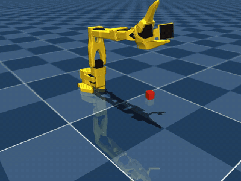

# SO-101

Reinforcement learning on a simulated SO-101, the 5-DoF + gripper arm used by
[LeRobot](https://github.com/huggingface/lerobot). The model is
[`robotstudio_so101`](https://github.com/google-deepmind/mujoco_menagerie/tree/main/robotstudio_so101)
from MuJoCo Menagerie. The pick-and-lift task and SAC setup are ported unchanged from the
[Koch v1.1 arm](../low_cost_robot_arm/), so this tests whether that recipe carries over to the
arm people actually build with LeRobot.

<p align="center"><br>
<sub>Pick-and-lift with SAC, 92% success.</sub></p>

## Highlights

- **Pick-and-lift with SAC: 92% success** over 200 evaluation episodes (cube 2.5 cm, random
  position and yaw, lift 5 cm and hold).
- **Same recipe, new robot:** only the robot-specific parts changed (joint names, jaw geometry,
  gripper direction, workspace). Reward, observation layout, action interface and SAC
  hyperparameters are the Koch ones. Eval success first hit 95% at 525k steps (Koch: 325k).
- **No real robot needed.** LeRobot's own SO-101 simulation is
  [LeIsaac](https://github.com/LightwheelAI/leisaac) (Isaac Lab, NVIDIA GPU). There is no
  official LeRobot MuJoCo environment for the SO-101, so this one is built on the Menagerie model.

## Results

SAC, 16 parallel simulators, 800k steps, 6.1 h (one GPU).

| Steps | 125k | 175k | 275k | 325k | 525k | 675k | 775k |
|---|---|---|---|---|---|---|---|
| Eval success (20 episodes) | 0% | 10% | 45% | 65% | 95% | 95% | 85% |

| Model (200 episodes, seeds 10000+) | Success | Return |
|---|---|---|
| Best checkpoint (by eval return) | 88% | 1672 ± 439 |
| Final model | **92%** | 1712 ± 416 |
| *Koch v1.1, same recipe (2M steps)* | *96%* | |

A scripted IK grasp (straight down onto the cube, close, lift) was run first to check that
the task is physically feasible before training. It succeeded in 85% of episodes. Its failures
were far cubes that the arm cannot reach with the jaws pointing straight down; SAC learns
angled grasps and handles those.

## Task

`pick_lift/env.py`:

| | |
|---|---|
| Action (6) | per-step change of the joint-position targets in [-1, 1]; 20 Hz control |
| Observation (35) | joint positions, velocities and targets; grasp centre, cube position and orientation; jaw-contact flags |
| Reward | reach + close near the cube + both jaws on the cube + lift while grasped + bonus while held lifted − action penalty |
| Success | cube held ≥ 5 cm above the table, gripped by both jaws, for 3 steps |
| Episode | 200 steps (10 s); ends early only if the cube is knocked out of reach |
| Cube | 2.5 cm, 20 g, 13–25 cm from the shoulder axis, ±0.6 rad around forward, ±0.5 rad yaw |

Differences from the Koch version:
- Arm faces +x, and the gripper closes towards negative angles.
- The gripper target is limited to 1.0 rad (9 cm opening) instead of the full 1.75 rad (13 cm).
- MuJoCo timestep is the Menagerie default of 5 ms, with frame skip 10.

## Project layout

```
so101/
  pick_lift/
    env.py         pick-and-lift environment
    train.py       train/evaluate (SAC)
    runs/          trained models, logs, TensorBoard (git-ignored)
  play.py          render a trained model to .mp4 / .webm / .gif (headless, via EGL)
  videos/          rendered videos
```

## Setup

Uses the repository's shared environment; see the [root README](../README.md#setup). The SO-101
model is added to the sparse Menagerie checkout with:

```bash
git -C mujoco_menagerie sparse-checkout add robotstudio_so101
```

## Usage

Run from the repository root.

```bash
# train: 800k steps, ~6 h with one GPU
uv run so101/pick_lift/train.py --name so101_pick_lift --timesteps 800000 --n-envs 16

# evaluate a saved model (success rate over N episodes)
uv run so101/pick_lift/train.py --eval-episodes 200 \
    --eval so101/pick_lift/runs/so101_pick_lift/final_model.zip

# render a video (default: so101/videos/pick_lift.mp4)
uv run so101/play.py so101/pick_lift/runs/so101_pick_lift/final_model.zip --episodes 4

# live training curves
uv run tensorboard --logdir so101/pick_lift/runs
```

## Next steps toward the real arm

The policy uses simulator state (exact cube pose), so it does not run on a real SO-101 as is.
The usual path:
- domain randomization (friction, mass, servo gains, latency), as done for the
  [Go2](../unitree_go2/#robustness)
- a camera-based policy, e.g. distilling this SAC expert into a vision policy on the wrist/top
  cameras
- LeRobot calibration so the simulated joint angles match the real servo readings

## Acknowledgements

- Robot model: [MuJoCo Menagerie](https://github.com/google-deepmind/mujoco_menagerie) (`robotstudio_so101`, SO-101 by The Robot Studio / Hugging Face).
- Physics: [MuJoCo](https://mujoco.org).
- RL algorithms: [Stable-Baselines3](https://github.com/DLR-RM/stable-baselines3).
