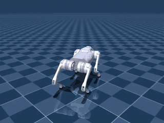
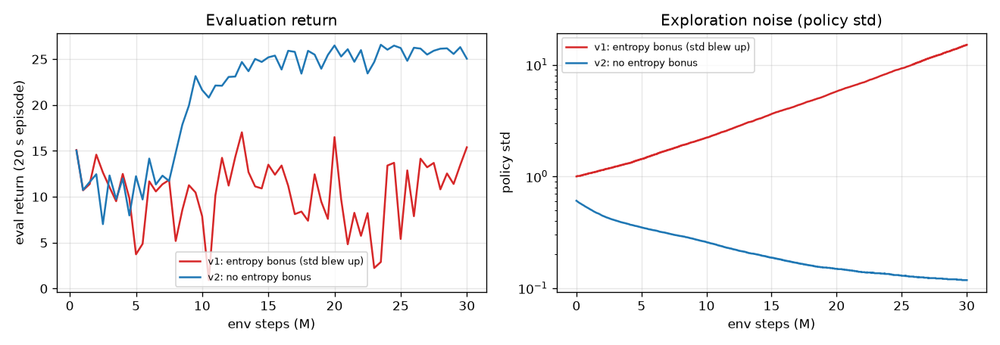
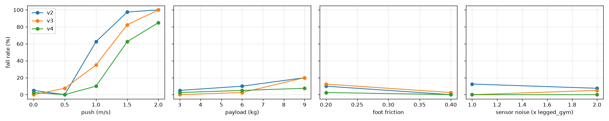
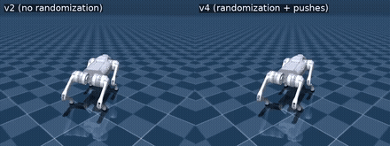

# Unitree Go2

Reinforcement learning for locomotion on a simulated Unitree Go2 quadruped (12 joints) from
[MuJoCo Menagerie](https://github.com/google-deepmind/mujoco_menagerie). A custom Gymnasium
environment trains a velocity-tracking walking policy with PPO (Stable-Baselines3), on the CPU
alone: 16 parallel simulators, 30M steps, 3.2 h.

<p align="center"><br>
<sub>Command tour: forward, forward + turn, sideways, backward, turn on the spot, stand.</sub></p>

## Highlights

- **Velocity tracking:** the robot walks at a commanded forward speed, sideways speed and
  turning rate, and switches between commands on the fly.
  - Tracking error **0.06 m/s**, **0%** falls over 20 evaluation episodes of 20 s.
  - Learns a trot (diagonal legs move together) without a gait being specified, only from a
    reward for following the command and taking real steps.
- **Robustness:** a follow-up policy trained with domain randomization survives what knocks the
  original over.
  - Varied foot friction, payload and motor strength, sensor noise, random pushes.
  - Falls under 1 m/s pushes: **62% → 10%**. Under 1.5 m/s pushes: 98% → 62%.
  - Tracking accuracy is unchanged.
  - It only worked as a curriculum: trained from scratch with all the disturbances on, the
    robot only learned to stand.
- **Debugging a failed run:** the first run trained for 30M steps and only learned to stand
  still. Its policy noise (std) grew from 1 to 15 because of an entropy bonus on clipped
  actions. Removing the bonus fixed it (see [lessons learned](#lessons-learned)).

<p align="center"></p>

## Results

Best model of v2, driven through a fixed tour of commands (`play.py`; measured = mean over the
segment after the transition):

| Segment | Command (vx, vy, wz) | Measured |
|---|---|---|
| Forward | 0.8, 0, 0 | 0.79, 0.05, -0.02 |
| Forward + turn left | 0.5, 0, 0.8 | 0.48, 0.05, 0.79 |
| Sideways left | 0, 0.4, 0 | -0.01, 0.41, -0.02 |
| Backward | -0.4, 0, 0 | -0.39, 0.02, -0.02 |
| Turn on the spot | 0, 0, -1.0 | 0.05, -0.03, -0.99 |
| Stand | 0, 0, 0 | 0.00, -0.01, -0.01 |

vx, vy in m/s (robot frame), wz in rad/s.

| Run (30M steps each) | Final policy std | Velocity error | Falls | Eval return |
|---|---|---|---|---|
| v1: entropy bonus 0.01, action scale 0.25 rad | 15.1 | 0.443 m/s (stands still) | 0% | 13.9 ± 6.4 |
| **v2:** no entropy bonus, action scale 0.5 rad, initial std 0.6 | 0.12 | **0.061 m/s** | **0%** | **26.3 ± 0.9** |

v2 walked forward and turned by 10M steps; sideways, backward and turning on the spot followed
by ~15M. Returns are per 20 s episode, evaluated on 20 episodes with random commands.

## Robustness

`walk/env.py` with `randomize=True`, following legged_gym. Every episode draws:

- **Foot friction:** 0.2–1.25 (nominal 0.8).
- **Payload on the base:** −1 to +3 kg (the robot is 15.2 kg).
- **Motor strength:** ±10% PD gain per joint.

During the episode:

- **Sensor noise:** uniform noise on every observation.
- **Pushes:** a random horizontal velocity kick of up to 1.5 m/s every 4–8 s.

| Run | Started from | Randomization | Steps | Result |
|---|---|---|---|---|
| v3 from scratch | random weights | friction 0.4–1.2, pushes ≤ 1 m/s | 30M | stands still (velocity error 0.5 m/s) |
| v3 | v2 | same | 15M | walks; fewer falls under 1 m/s pushes |
| **v4** | v3 | friction 0.2–1.25, pushes ≤ 1.5 m/s | 15M | best (below) |

`walk/robustness.py` changes one thing at a time from the nominal robot. Each cell is 40 episodes
of 20 s with random commands; pushes come every 3 s in a random direction. Cells give the fall
rate (velocity error in m/s):

| Condition | v2 | v3 | **v4** |
|---|---|---|---|
| Nominal | 5% (0.08) | 0% (0.07) | 2% (0.08) |
| Push 0.5 m/s | 0% | 8% | 0% |
| Push 1.0 m/s | 62% | 35% | **10%** |
| Push 1.5 m/s | 98% | 82% | **62%** |
| Push 2.0 m/s | 100% | 100% | 85% |
| Payload +6 kg | 10% | 2% | 5% |
| Payload +9 kg (outside training range) | 20% | 20% | **8%** |
| Foot friction 0.2 | 10% | 12% | **2%** |
| Sensor noise ×2 | 8% | 5% | **0%** |

<p align="center"></p>

The same command tour with a 1.5 m/s push every 3 s (left, forward, right, back). v2 falls after
10 s; v4 finishes the tour:

<p align="center"></p>

## Task

`walk/env.py`: every episode samples a command (vx ∈ [-0.5, 1.0] m/s, vy ∈ [-0.5, 0.5] m/s,
wz ∈ [-1, 1] rad/s; 10% of the time: stand still) and resamples it after 10 s.

| | |
|---|---|
| Control | 50 Hz policy outputs joint-position targets = standing pose + 0.5 rad × action. A joint PD controller (kp 35, kd 0.5, torque-limited) runs at 250 Hz inside MuJoCo, as on the real robot. |
| Observation | 48-dim, all in the robot's own frame: base linear and angular velocity, gravity direction (tilt), command, joint positions and velocities, previous action |
| Episode | 1000 steps (20 s); ends early if the robot falls (tilt > 60° or base below 15 cm) |
| Reward | weighted sum × dt (legged_gym style): + velocity tracking `exp(-err²/0.25)` (linear and yaw), + feet air time (steps longer than 0.5 s), − vertical bouncing, roll/pitch rate, tilt, torque, joint acceleration, action change, thigh/calf contact with the floor |

Each reward term is logged to TensorBoard separately (`reward/<term>`), together with
`walk/lin_vel_error` and `walk/fall_rate`.

PPO: 16 envs × 1024 steps per rollout, minibatch 4096, 5 epochs, lr 3e-4, γ 0.99, GAE λ 0.95,
clip 0.2, no entropy bonus, actor and critic MLPs [512, 256, 128] with ELU.

## Project layout

```
unitree_go2/
  walk/
    env.py         velocity-tracking environment
    train.py       train/evaluate (PPO; --randomize, --init to continue from a model)
    robustness.py  stress test: pushes, payload, foot friction, sensor noise (table + plot)
    runs/          trained models, logs, TensorBoard (git-ignored)
  play.py          render a model through a fixed command tour to .mp4 / .webm / .gif (headless)
  videos/          rendered videos and plots
```

## Setup

Uses the repository's shared environment; see the [root README](../README.md#setup). The Go2
model is added to the sparse Menagerie checkout with:

```bash
git -C mujoco_menagerie sparse-checkout add unitree_go2
```

## Usage

Run from the repository root.

```bash
# train: 30M steps, ~3.2 h on 8 CPU cores
uv run unitree_go2/walk/train.py --name walk_ppo

# evaluate: fall rate and velocity-tracking error
uv run unitree_go2/walk/train.py --eval-episodes 20 \
    --eval unitree_go2/walk/runs/walk_ppo/best_model.zip

# render the command tour (default: unitree_go2/videos/walk.mp4)
uv run unitree_go2/play.py unitree_go2/walk/runs/walk_ppo/best_model.zip

# robustness curriculum: continue the walker with domain randomization (15M steps, ~1.6 h each)
uv run unitree_go2/walk/train.py --randomize --timesteps 15000000 --name walk_ppo_robust \
    --init unitree_go2/walk/runs/walk_ppo/best_model.zip

# stress test and compare models (default plot: unitree_go2/videos/robustness.png)
uv run unitree_go2/walk/robustness.py --episodes 40 \
    v2=unitree_go2/walk/runs/walk_ppo/best_model.zip \
    robust=unitree_go2/walk/runs/walk_ppo_robust/best_model.zip

# command tour with a 1.5 m/s push every 3 s
uv run unitree_go2/play.py unitree_go2/walk/runs/walk_ppo_robust/best_model.zip --push 1.5

# live training curves
uv run tensorboard --logdir unitree_go2/walk/runs
```

## Lessons learned

- **An entropy bonus with clipped actions can blow up exploration.**
  - The policy is a Gaussian whose samples are clipped to [-1, 1]. Beyond the clip, a wider
    Gaussian costs nothing, while the entropy bonus keeps paying for it.
  - The std grew from 1 to 15 in v1, so training actions were pure ±1 noise and the policy
    never learned a gait. Standing still was the safest behaviour, so the reward curve looked
    flat but not broken.
  - Check the `std` (or entropy) curve, and watch the policy: a flat reward with zero falls
    looked fine on paper.
- **Profile before scaling up.** The environment spent most of its time in Python, not physics.
  - Moving the PD loop into MuJoCo position actuators (C instead of Python) doubled the speed.
  - The pyramidal friction cone was another 1.7× faster than the elliptic one, with the same
    standing pose. The MJX model's single solver iteration made the CPU simulation blow up.
  - On this 8-core CPU, a small MLP policy trained faster on the CPU than on the GPU: every env
    step needs a policy forward pass, and GPU transfers cost more than the math.
- **Disturbances need a curriculum.**
  - With pushes, payload and sensor noise from step 0, the robot never learned to walk: standing
    still was the safest behaviour.
  - Starting from the nominal walker and switching the randomization on kept the gait and added
    robustness.
  - v4 was trained on pushes up to 1.5 m/s and friction down to 0.2, where v3 had been weak. It
    fixed exactly those cases.
  - Even a +9 kg payload, outside the training range, became 3× safer.
- **Why PPO here.** Locomotion needs tens of millions of steps. PPO does 20 large-batch updates
  per 16k transitions, while SAC (as configured for the [robot arm](../low_cost_robot_arm/))
  does one update per transition, about 30M updates for this run. With cheap simulation, PPO
  is the standard choice for locomotion (legged_gym, Isaac Lab, MuJoCo Playground); SAC was not
  tested on this task.

## Acknowledgements

- Robot model: [MuJoCo Menagerie](https://github.com/google-deepmind/mujoco_menagerie) (Unitree Go2).
- Physics: [MuJoCo](https://mujoco.org).
- RL algorithms: [Stable-Baselines3](https://github.com/DLR-RM/stable-baselines3).
- Reward design follows Rudin et al., *Learning to Walk in Minutes Using Massively Parallel Deep
  Reinforcement Learning* (legged_gym), CoRL 2021.
